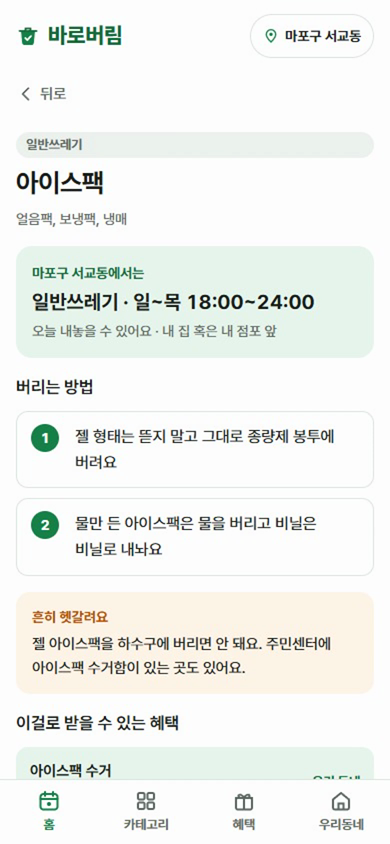

# ♻️ 바로버림

동네를 한 번 고르면 **오늘 내놓을 수 있는 쓰레기, 품목별 분리배출 방법, 버리고 돌려받을 수 있는 혜택을 그 동네 규칙에 맞춰 알려주는 모바일 웹앱**.

* **Frontend**: `public/` — HTML + CSS + Vanilla JS
* **Backend**: `server.js` — Node.js (`http` 모듈, 외부 패키지 없음)
* **Deploy**: Vercel (정적 파일 + 서버리스 함수)
* **Service**: [bin-right.vercel.app](https://bin-right.vercel.app/)

<p align="center">
  
  
  
  
  
</p>

---

## ✨ 주요 기능

### 📍 동네 고르기

시·도 → 시·군·구 → 읍·면·동 순서로 전국 어디든 고를 수 있음.

배출 요일과 장소는 같은 구 안에서도 관리구역마다 다르기 때문에, 고른 동이 포함된 관리구역을 찾아 그 구역의 규칙을 적용함.

한 번 고르면 브라우저에 저장되어 다음부터는 바로 홈 화면이 열림.

---

### 📅 오늘 배출 안내

홈 화면에서 **오늘 내놓을 수 있는 쓰레기 종류와 시간**을 가장 먼저 보여줌.

일반쓰레기·음식물·재활용별로 다음 배출일, 배출 장소, 봉투 종류를 정리하고, 이번 주 배출 달력도 함께 보여줌.

오늘 배출이 없는 날에는 "내일 ○○ 배출" 또는 "다음 배출일까지 집에 보관해 주세요"로 안내함.

---

### 🔍 품목 검색

"이건 어디에 버려요?"를 바로 찾을 수 있도록 검색어를 여러 방식으로 받음.

```text
아이스팩   → 정확히 일치
ㅇㅇㅍ     → 초성 검색
보냉팩     → 별칭으로 검색 (아이스팩)
아이스펙   → 한 글자 오타 허용 (편집 거리 1)
```

정확 일치 → 앞부분 일치 → 포함 → 오타 순으로 점수를 매겨 정렬하고, 별칭으로 찾은 경우에는 "보냉팩(으)로 검색됨"처럼 표시함.

---

### 📄 품목 상세

품목마다 **버리는 방법을 단계별로** 보여주고, 그 품목이 속한 분류의 **우리 동네 배출 요일과 장소**를 함께 표시함.

```text
아이스팩
  ├─ 마포구 서교동에서는: 일반쓰레기 · 일~목 18:00~24:00
  ├─ 버리는 방법: 1. 젤 형태는 뜯지 말고 종량제 봉투에  2. 물만 든 건 물 버리고 비닐로
  ├─ 흔히 헷갈려요: 젤을 하수구에 버리면 안 됨
  └─ 이걸로 받을 수 있는 혜택: 아이스팩 수거
```

대형폐기물(신고 후 배출), 폐건전지·폐의약품(전용 수거함)처럼 요일과 상관없는 품목은 따로 안내함.

---

### 🤖 AI에게 물어보기

검색으로 나오지 않는 물건이나 "치킨 먹고 남은 뼈랑 상자는?" 같은 애매한 상황을 채팅으로 물어볼 수 있음.

서버가 **고른 동네의 배출 규칙과 품목 사전**으로 시스템 프롬프트를 만들어 Gemini에 보내기 때문에, 일반론이 아니라 그 동네 기준으로 답함.

답변은 스트리밍으로 바로바로 보여주고, API 남용을 막기 위해 IP당 분당 10회로 제한함.

---

### 🎁 버리고 돌려받기

* **주민센터 교환 사업**: 우유팩 → 화장지, 폐건전지 → 새 건전지 같은 동네 교환 사업을 웹에서 찾아 출처와 함께 정리
* **전국 포인트·환급 제도**
* **근처 수거함**: 폐건전지·폐의약품 수거함을 반경 2km 안에서 찾고, 없으면 행정복지센터·대형마트·약국 안내

---

### 🏠 우리동네

요일표, 분류별 배출 장소와 봉투, 미수거일, 구청 담당 부서와 전화번호를 한 화면에 모음.

---

# 🛠️ 기술 스택

### Frontend

* HTML / CSS
* Vanilla JavaScript (프레임워크 없음)

### Backend

* Node.js 20.12+ (`http` 모듈, 외부 의존성 없음)

### API

* 공공데이터포털 — 행정안전부 생활쓰레기배출정보
* 공공데이터포털 — 폐형광등·폐건전지 수거함, 폐의약품 수거함 전국 표준데이터
* 서울 열린데이터광장 · 구청 공공데이터 — 서울 자치구 폐건전지 수거함 파일
* 카카오 로컬 API — 주변 장소, 주소 → 좌표 변환
* 다음 검색 API — 주민센터 교환 사업 글 검색
* Google Gemini API — AI 채팅, 교환 사업 정리

### Storage

* Upstash Redis (Vercel KV) — 서버리스 인스턴스끼리 캐시 공유
* `cache/*.json` — 로컬 실행 시 파일 캐시

### Deploy

* Vercel

---

# 📂 프로젝트 구조

```text
BinRight/
├── public/
│   ├── index.html        # 화면 뼈대 (상단 바, 하단 탭, 지역 설정)
│   ├── app.js            # 화면 렌더링 · 검색 · 라우팅 · AI 채팅
│   ├── data.js           # 품목 사전 · 예시 지역 · 혜택 (브라우저와 서버가 함께 사용)
│   ├── regions-kr.json   # 전국 시·도 / 시·군·구 / 읍·면·동 목록
│   └── styles.css
│
├── api/
│   └── index.js          # Vercel 서버리스 진입점 → server.js
│
├── data/bins/            # API 없는 지역의 수거함 CSV를 직접 넣는 곳
│
├── server.js
├── waste.js
├── bins.js
├── seoul-bins.js
├── places.js
├── exchange.js
├── store.js
└── vercel.json
```

### 주요 파일

| 파일 | 역할 |
| --- | --- |
| `server.js` | 정적 파일 제공, API 라우팅, Gemini 프록시와 시스템 프롬프트 생성 |
| `waste.js` | 생활쓰레기배출정보 조회, 요일 파싱, 관리구역별 최신본만 남기기 |
| `bins.js` | 폐건전지·폐의약품 수거함 전체를 하루 한 번 받아 좌표 거리로 검색 |
| `seoul-bins.js` | 서울 자치구 수거함 파일의 최신 링크를 매일 찾아 받고, 좌표 없는 주소는 카카오로 변환 |
| `places.js` | 혜택 탭 주변 장소 (공공 수거함 + 카카오) |
| `exchange.js` | 교환 사업 글 검색 → 그 구·동 글만 골라 Gemini로 정리, 2주 캐시 |
| `store.js` | Upstash Redis 공유 저장소 (없으면 파일 캐시만 사용) |
| `public/data.js` | 품목 43개 사전, 시연용 예시 지역 6곳, 혜택 데이터 |

### API

| 경로 | 설명 |
| --- | --- |
| `GET /api/config` | 켜져 있는 기능 (AI, 지역 데이터, 주변 장소, 교환 사업) |
| `GET /api/waste?sgg=마포구` | 시·군·구의 관리구역별 배출 규칙 |
| `GET /api/places?area=…&sido=…&sgg=…&dong=…` | 근처 수거함과 장소 |
| `GET /api/exchange?sido=…&sgg=…&dong=…` | 주민센터 교환 사업 |
| `POST /api/ask` | AI 답변 스트리밍 |

---

# 🔧 개발하면서 해결한 문제

## 1. 같은 관리구역의 옛 버전 데이터가 섞여서 오는 문제

생활쓰레기배출정보 API로 한 구를 조회하면 같은 관리구역이 여러 줄 반환되는 경우가 있었음.

확인해 보니 관리번호 앞자리가 연도였고, **예전에 등록된 버전과 갱신된 버전이 함께 남아 있는 것**이었음. 그대로 쓰면 같은 동네에 서로 다른 배출 요일이 두 개 나올 수 있었음.

그래서 `시·도 + 시·군·구 + 관리구역명 + 대상 지역`을 하나의 키로 묶고, 갱신 시점과 관리번호가 가장 최신인 한 줄만 남기도록 함.

---

## 2. 배출 요일 표기가 지자체마다 제각각인 문제

같은 "배출 요일" 항목인데도 지자체마다 쓰는 방식이 달랐음.

```text
일+월+화
월~금
매일
월요일, 수요일
```

이 값을 그대로 보여주면 "오늘 내놓을 수 있는지"를 계산할 수 없어서, 모든 표기를 **요일 번호 배열**(`[0, 1, 2, 3, 4]`)로 바꾸는 `parseDays`를 만듦. `토~월`처럼 주말을 넘어가는 범위도 처리함.

시간도 `18:00`, `1800`, `18시`처럼 섞여 있어서 `18:00~24:00` 형태로 통일함.

---

## 3. 자료마다 지역 이름이 다른 문제

사용자가 고르는 동네 목록(행정동)과 공공데이터의 지역 이름이 일치하지 않는 경우가 많았음.

* **시·도 이름 변경**: 전라북도 ↔ 전북특별자치도, 강원도 ↔ 강원특별자치도
* **시·군 표기 생략**: 목록은 `남양주시`인데 데이터는 `남양주`로 등록된 곳
* **세종**: 세종시 ↔ 세종특별자치시
* **법정동과 행정동**: 고양시 덕양구처럼 데이터에 법정동 이름(동산동)이 쓰여 있어 행정동(창릉동)으로는 찾아지지 않는 곳

그래서 시·도는 앞 두 글자 약칭으로 비교하고, 시·군·구는 같은 구 → 시 전체 순서로 후보를 좁힌 뒤, 그 안에서 동 이름이 들어 있는 관리구역 → 구 전체 구역 → 첫 구역 순서로 고르도록 함. 법정동은 행정동으로 바꾸는 표를 따로 둠.

그래도 맞는 자료가 없으면 "곧 채워져요"가 아니라 **"이 동네는 배출 요일 자료가 없어요"**라고 정확히 안내하도록 바꿈.

---

## 4. 명세서와 실제 응답의 필드 이름이 다른 문제

폐형광등·폐건전지 수거함 API는 명세서에 필드가 대문자(`INSTL_PLC_NM`)로 적혀 있었지만, 실제 응답은 camelCase(`instlPlcNm`)였음. 명세서대로만 구현하면 값이 전부 비어 버림.

그래서 두 형식을 모두 받도록 처리함.

또 수거함 데이터는 지자체마다 시·군·구 표기가 달라서 이름으로 거르면 빠지는 곳이 생겼음. 그래서 **전체 데이터를 하루 한 번 받아 두고, 이름 대신 좌표 거리(반경 2km)로 찾도록** 바꿈.

---

## 5. 전국 표준데이터에 서울 수거함이 거의 없는 문제

폐건전지 수거함 전국 표준데이터에는 서울이 은평구 하나뿐이었음.

서울 자치구들은 공공데이터포털 파일데이터, 서울 열린데이터광장, 구청 홈페이지에 각자 파일을 올려 두고 있어서, 이 파일들을 모으는 `seoul-bins.js`를 만듦.

파일은 갱신될 때마다 다운로드 링크가 바뀌기 때문에, 링크를 고정하지 않고 **서버가 매일 각 페이지에서 최신 파일 링크를 찾아 받도록** 함. 컬럼 이름도 파일마다 달라서 이름 패턴으로 찾고, 좌표가 없는 파일은 카카오 주소 검색으로 좌표를 구해 저장함.

현재 서울 11개 구 데이터를 보충하고 있고, 다른 지역은 `data/bins/`에 CSV를 넣으면 읽음.

---

## 6. 공공데이터포털이 멈추면 지역 데이터가 사라지는 문제

공공데이터포털은 점검이나 장애로 응답하지 않을 때가 있음. 실제로 개발 중에도 `data.go.kr`에 접속이 되지 않아 지역 데이터가 비어 버리는 상황을 겪음.

Vercel 서버리스 환경은 인스턴스마다 메모리가 따로이고 금방 사라지기 때문에, 메모리 캐시만으로는 이 문제를 막을 수 없었음.

그래서 받아 온 배출 정보를 **Upstash Redis 공유 저장소에 1년 동안 보관**하고, 포털이 응답하지 않으면 마지막으로 받은 내용을 대신 보여주도록 함. 수거함 목록과 좌표, 교환 사업 검색 결과도 같은 저장소를 함께 씀.

---

## 7. 교환 사업 정보가 정리된 공공 자료가 없는 문제

주민센터 교환 사업(우유팩 → 화장지 등)은 동네마다 하는지 안 하는지, 언제까지 하는지가 공식 데이터로 정리되어 있지 않았음.

그래서 다음 검색으로 블로그·웹문서를 찾고, **그 구·동 이름이 실제로 나오는 글만 골라** Gemini가 교환 품목과 받는 물건으로 정리하도록 함.

AI가 정리한 내용이라 틀릴 수 있어서 항상 **출처 글을 함께 보여주고**, 2년 넘은 글은 버리고, 이미 끝난 하루·기간 행사는 숨기도록 함.

---

# ⚠️ 현재 한계

### 공공데이터 의존

배출 요일은 행정안전부 자료를 기준으로 하기 때문에, 구청 공지가 바뀌어도 자료가 갱신되기 전까지는 반영되지 않음. 실제 구청 공지와 다르면 구청 안내가 우선임.

### 품목 사전 규모

품목 사전은 현재 43개. 사전에 없는 물건은 AI 채팅으로 안내하고 있지만, 자주 찾는 품목을 계속 추가해야 함.

### AI 답변의 정확도

AI 채팅과 교환 사업 정리는 Gemini가 만든 결과라 틀릴 수 있음. 화면에 이 점을 함께 표시하고 있음.

### 외부 API 호출 한도

Gemini, 카카오, 공공데이터포털 모두 무료 호출 한도가 있음. 캐시로 호출을 줄이고 있지만 사용자가 많아지면 한도에 걸릴 수 있음.

---

# 🚀 실행 방법

```bash
git clone https://github.com/puara-g/BinRight.git
cd BinRight
npm install
cp .env.example .env
npm start
```

```text
http://localhost:3000
```

개발할 때는 `npm run dev`로 실행하면 파일이 바뀔 때마다 서버가 자동으로 다시 켜짐.

---

## 🔑 환경변수

`.env`에 API 키를 입력함. 모두 무료로 발급받을 수 있음.

```env
GEMINI_API_KEY=YOUR_KEY
GEMINI_MODEL=gemini-3.5-flash-lite
DATA_GO_KR_API_KEY=YOUR_KEY
KAKAO_REST_API_KEY=YOUR_KEY
PORT=3000

# 선택: Vercel KV / Upstash Redis 공유 저장소
KV_REST_API_URL=
KV_REST_API_TOKEN=
```

| 키 | 발급처 | 없으면 |
| --- | --- | --- |
| `GEMINI_API_KEY` | [Google AI Studio](https://aistudio.google.com) | AI 채팅과 교환 사업 정리가 꺼짐 |
| `DATA_GO_KR_API_KEY` | [공공데이터포털](https://www.data.go.kr) '행정안전부_생활쓰레기배출정보' 활용신청 | 시연용 예시 지역 6곳만 보임 |
| `KAKAO_REST_API_KEY` | [카카오 개발자](https://developers.kakao.com) (카카오맵 사용 ON) | 근처 장소 대신 일반 안내만 보이고, 교환 사업 검색도 꺼짐 |

키가 하나도 없어도 품목 검색, 품목 상세, 예시 지역 배출 안내는 그대로 동작하도록 구성함.

---

# 🏗️ 배포 구조

```text
사용자
  │
  ▼
Vercel
  ├── public/          정적 파일 (HTML, CSS, JS)
  └── api/index.js     /api/* → server.js (서버리스 함수)
          │
          │ API Key 사용
          ├──────────▶ 공공데이터포털 · 서울 열린데이터광장
          ├──────────▶ 카카오 로컬 / 다음 검색
          ├──────────▶ Google Gemini
          │
          ▼
     Upstash Redis     배출 정보 · 수거함 · 교환 사업 캐시 공유
```

API Key는 브라우저에 포함하지 않고 서버에서만 사용함. AI 시스템 프롬프트도 서버가 `public/data.js`의 품목 사전과 동네 규칙으로 만듦.

---

# 💡 프로젝트를 통해 배운 점

이번 프로젝트에서 가장 많이 겪은 건 **공공데이터가 생각보다 고르지 않다는 점**이었음.

같은 항목인데도 지자체마다 표기가 다르고, 옛 버전이 섞여 있고, 명세서와 실제 응답이 다르고, 어떤 지역은 아예 자료가 없었음. 그래서 데이터를 받아서 보여주는 것보다 **받은 데이터를 정리하고, 맞지 않는 경우를 하나씩 찾아 처리하는 일**에 더 많은 시간을 씀.

또 외부 서비스는 언제든 멈출 수 있다는 걸 직접 겪으면서, 캐시와 fallback을 처음부터 설계해야 한다는 걸 알게 됨.

사용자 입장에서는 "아이스팩은 일반쓰레기"라는 정보만으로는 부족하고 **"그래서 우리 집 앞에 언제 내놓으면 되는지"**까지 알려줘야 한다고 생각했고, 품목 정보와 동네 배출 규칙을 하나로 연결하는 데 집중함.

앞으로는 품목 사전을 늘리고, 더 많은 지역의 수거함 데이터를 연결해서 전국 어디서나 바로 쓸 수 있는 서비스로 발전시키고 싶음.

---

## 🔗 Repository

**GitHub:** [puara-g/BinRight](https://github.com/puara-g/BinRight)
