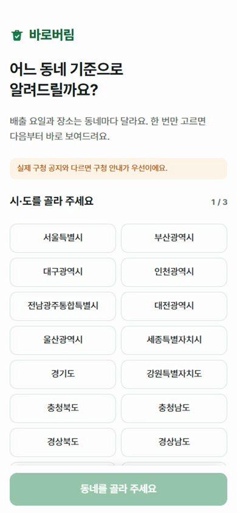
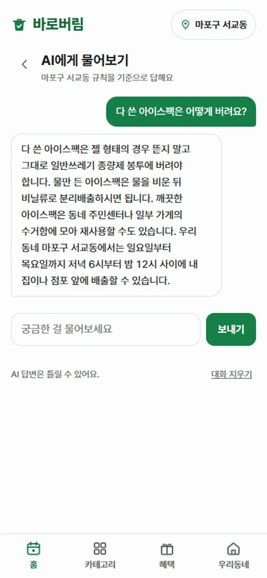
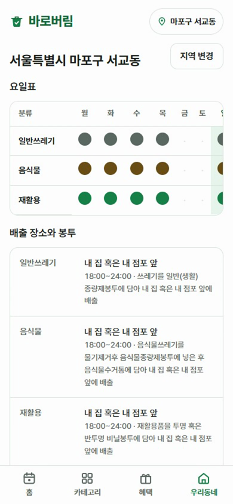

<div align="center">


# 바로버림 BinRight

**우리 동네 분리배출 도우미**

오늘 뭘 내놓는 날인지, 이 물건은 어디에 버리는지, 버리고 뭘 돌려받을 수 있는지 한 번에 알려주는 모바일 우선 웹앱

[**🌐 바로 써 보기**](https://bin-right.vercel.app/)


</div>

<br>

<p align="center">
  
  
  
  
  
</p>

## 왜 만들었나요?

"아이스팩 버리는 법"을 검색하면 블로그마다 말이 다르고, 구청 홈페이지에는 긴 표가 접혀 있어요. 게다가 **배출 요일과 장소는 동네마다 달라요.**
바로버림은 동네를 한 번만 고르면 그 동네 규칙에 맞춰 바로 답해 줘요.

## 주요 기능

| | 기능 | 설명 |
|---|---|---|
| 📅 | **오늘 배출 안내** | 오늘 내놓을 수 있는 쓰레기 종류와 시간, 이번 주 배출 달력 |
| 🔍 | **품목 검색** | 초성(`ㅇㅇㅍ`), 별칭(`보냉팩` → 아이스팩), 오타까지 찾아 주는 검색 |
| 📄 | **품목 상세** | 버리는 방법 단계별 안내 + "우리 동네에서는 언제·어디에" + 흔히 헷갈리는 점 |
| 🤖 | **AI에게 물어보기** | 검색으로 안 나오는 애매한 상황을 동네 규칙 기준으로 답해 주는 채팅 (Gemini) |
| 🎁 | **버리고 돌려받기** | 주민센터 교환 사업, 포인트·환급 제도, 근처 폐건전지·폐의약품 수거함 |
| 🏠 | **우리동네** | 요일표, 배출 장소와 봉투, 구청 담당 부서와 전화번호 |

## 사용한 데이터

| 데이터 | 출처 | 쓰는 곳 |
|---|---|---|
| 생활쓰레기 배출정보 | [공공데이터포털 · 행정안전부](https://www.data.go.kr/data/15025450/standard.do) | 전국 동네별 배출 요일·시간·장소 |
| 폐형광등·폐건전지 수거함 | 공공데이터포털 전국 표준데이터 + 서울 11개 구 파일 | 혜택 탭 근처 수거함 (반경 2km) |
| 폐의약품 수거함 | 공공데이터포털 전국 표준데이터 | 혜택 탭 근처 수거함 |
| 주변 장소 | 카카오 로컬 API | 행정복지센터, 대형마트·약국 |
| 주민센터 교환 사업 | 다음 검색 → Gemini 정리 (출처 함께 표시) | 혜택 탭 우리 동네 교환 |

> 공공데이터포털이 응답하지 않을 때는 마지막으로 받은 데이터를 저장해 두었다가 대신 보여 줘요.

## 시작하기

### 요구 사항

- Node.js **20.12 이상**
- API 키 (모두 무료, 없어도 실행됨)

### 설치와 실행

```bash
git clone https://github.com/puara-g/BinRight.git
cd BinRight
npm install
cp .env.example .env   # 아래 표를 보고 키 입력
npm start              # http://localhost:3000
```

개발할 때는 `npm run dev`로 실행하면 파일이 바뀔 때마다 서버가 자동으로 다시 켜져요.

### 환경 변수

| 이름 | 발급처 | 없으면 |
|---|---|---|
| `GEMINI_API_KEY` | [Google AI Studio](https://aistudio.google.com) | AI 채팅과 교환 사업 정리가 꺼져요 |
| `DATA_GO_KR_API_KEY` | [공공데이터포털](https://www.data.go.kr) → '행정안전부_생활쓰레기배출정보' 활용신청 | 시연용 예시 지역 6곳만 보여요 |
| `KAKAO_REST_API_KEY` | [카카오 개발자](https://developers.kakao.com) → 앱 키 (카카오맵 사용 ON) | 근처 장소 대신 일반 안내만 보이고, 교환 사업 검색도 꺼져요 |
| `GEMINI_MODEL` | | 기본값 `gemini-3.5-flash-lite` |
| `PORT` | | 기본값 `3000` |
| `KV_REST_API_URL` · `KV_REST_API_TOKEN` | Vercel KV / Upstash Redis (선택) | 교환 사업 검색 결과를 서버마다 따로 저장해요 |

> 🔒 API 키는 서버에만 있고 브라우저로 나가지 않아요. AI 시스템 프롬프트도 서버가 만들어요.

## 배포

[Vercel](https://vercel.com)에 그대로 올리면 돼요. `public/`은 정적 파일로, `/api/*` 요청은 `api/index.js` 서버리스 함수가 `server.js`로 넘겨 처리해요 ([vercel.json](vercel.json)). 환경 변수는 Vercel 프로젝트 설정에 넣어 주세요.

## 프로젝트 구조

```
BinRight/
├── server.js        # 정적 파일 + API 라우팅 (/api/waste, /api/places, /api/exchange, /api/ask)
├── waste.js         # 생활쓰레기 배출정보 조회 · 요일 파싱 · 옛 버전 중복 제거
├── places.js        # 혜택 탭 주변 장소 (공공 수거함 + 카카오)
├── bins.js          # 폐의약품 · 폐건전지 수거함 (하루 한 번 전체 받기, 좌표 거리로 검색)
├── seoul-bins.js    # 서울 11개 구 폐건전지 수거함 파일 자동 수집
├── exchange.js      # 주민센터 교환 사업 검색 → Gemini 정리, 2주 캐시
├── store.js         # Vercel 공유 저장소 (Upstash Redis, 선택)
├── api/index.js     # Vercel 서버리스 진입점
├── data/bins/       # API 없는 지역의 수거함 CSV를 넣는 곳
└── public/
    ├── index.html   # 화면 뼈대 (상단 바, 하단 탭, 지역 설정)
    ├── app.js       # 화면 렌더링 · 검색 · 라우팅 · AI 채팅
    ├── data.js      # 품목 사전 · 지역 규칙 · 혜택 (브라우저와 서버가 함께 사용)
    ├── styles.css
    └── regions-kr.json  # 전국 시·도 / 시·군·구 / 읍·면·동 목록
```

## API

| 경로 | 설명 |
|---|---|
| `GET /api/config` | 켜져 있는 기능 (AI, 지역 데이터, 주변 장소, 교환 사업) |
| `GET /api/waste?sgg=마포구` | 시·군·구의 관리구역별 배출 규칙 |
| `GET /api/places?area=…&sido=…&sgg=…&dong=…` | 근처 수거함과 장소 |
| `GET /api/exchange?sido=…&sgg=…&dong=…` | 주민센터 교환 사업 |
| `POST /api/ask` | AI 답변 스트리밍 (IP당 분당 10회 제한) |

## 참고

- 배출 요일·장소는 실제 구청 공지와 다를 수 있어요. 다르면 **구청 안내가 우선**이에요.
- AI 답변은 틀릴 수 있어요.
